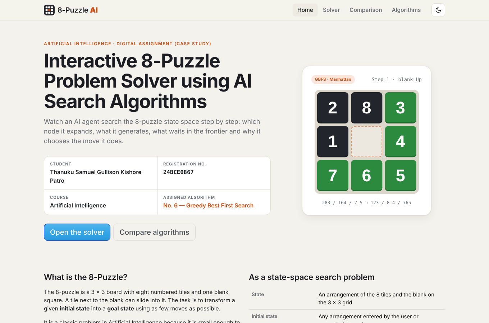
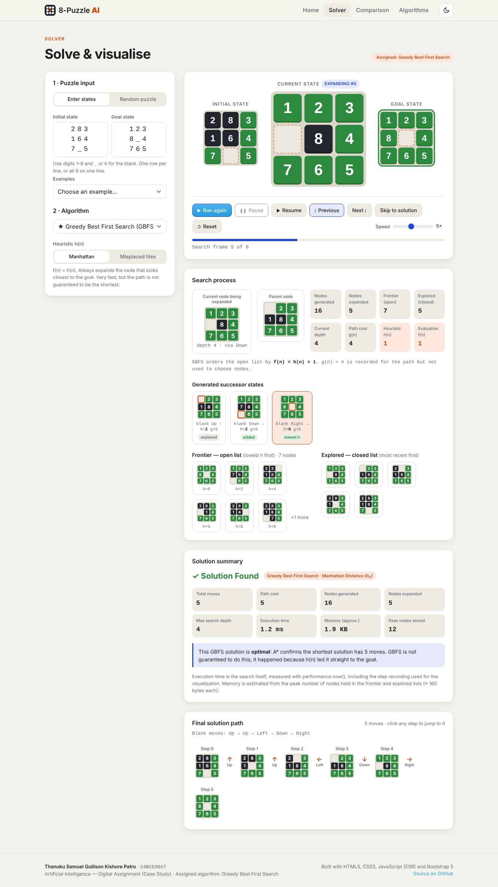
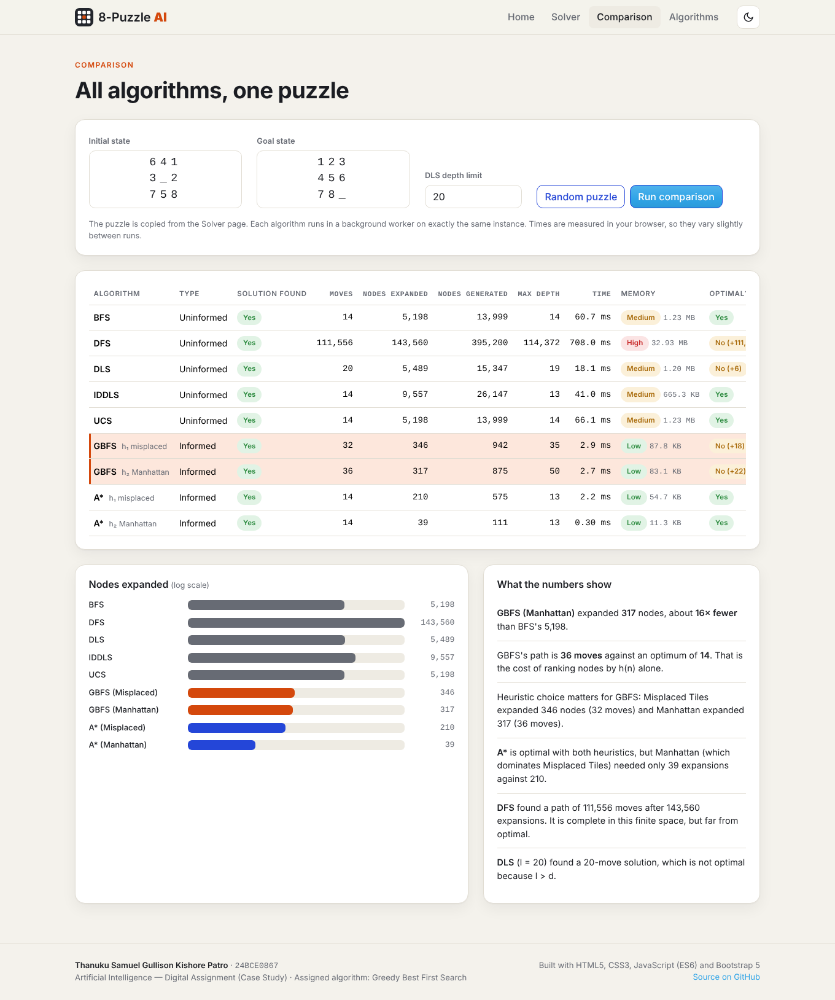
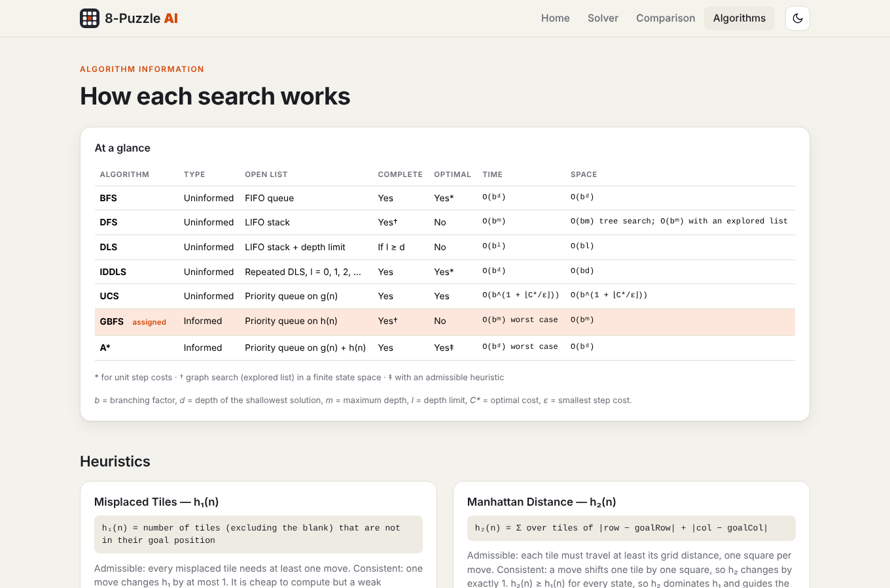
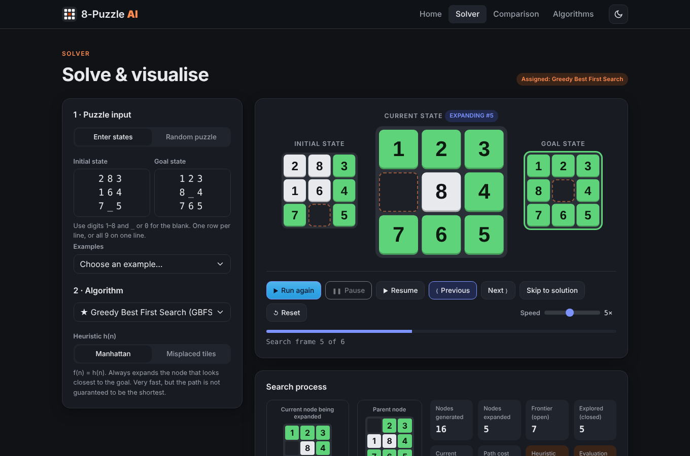
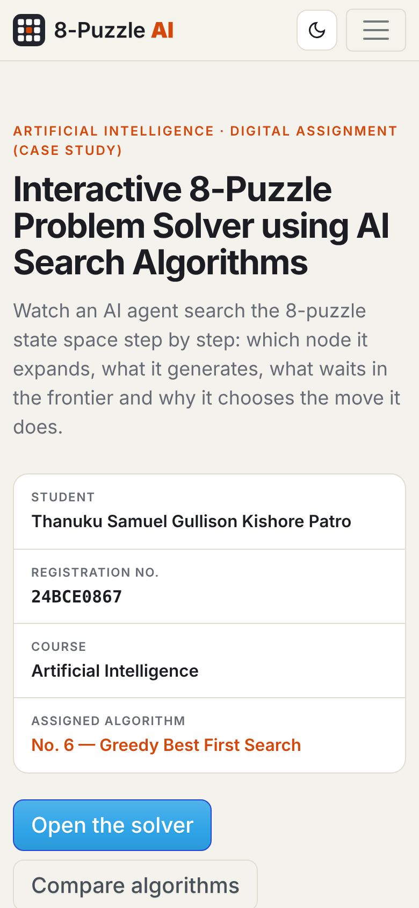

# Interactive 8-Puzzle Problem Solver using AI Search Algorithms

**Artificial Intelligence — Digital Assignment (Case Study, 10 marks)**
**Assigned algorithm: No. 6 — Greedy Best First Search (GBFS)**

| | |
|---|---|
| **Student** | Thanuku Samuel Gullison Kishore Patro |
| **Registration No.** | 24BCE0867 |
| **Course** | Artificial Intelligence |
| **Assigned algorithm** | Greedy Best First Search (Algorithm No. 6) |
| **Live website (GitHub Pages)** | https://samuelpatro2007-svg.github.io/AI-8Puzzle-Visualizer/ |
| **Repository** | https://github.com/samuelpatro2007-svg/AI-8Puzzle-Visualizer |
| **Demo video** | [`assets/demo-video.mp4`](assets/demo-video.mp4) |



---

## Project description

An interactive web application that solves the **8-Puzzle** as a state-space search problem and shows, step by step, how an AI search algorithm explores that space.

The assigned algorithm, **Greedy Best First Search**, is the default and is highlighted throughout. For each expansion the visualiser shows:

- the **current node being expanded** and its **parent node**,
- the **successor states** generated by moving the blank (with `h(n)`, `g(n)` and `f(n)` and whether each one was added, already in the frontier, or already explored),
- the **frontier (open list)**, ordered by `h(n)`, and the **explored (closed list)**,
- **nodes generated / expanded**, **current depth** and **path cost**.

After the goal is found, the tiles animate along the **final solution path**. A **solution summary** reports moves, nodes generated and expanded, maximum depth, execution time, path cost and approximate memory. For GBFS the summary also checks the path against A* and reports how many moves longer than optimal it is, which shows directly that GBFS is not optimal.

For context and for the comparison page, the remaining algorithms from the assignment (BFS, DFS, DLS, IDDLS, UCS and A*) are implemented with the same engine.

### Features (mapped to the assignment)

| Requirement | Where |
|---|---|
| 1. Home page: course, title, student name, reg. no., introduction, navigation | `#home` |
| 2. Puzzle input: Method 1 (enter initial and goal state), Method 2 (**Generate Random Puzzle**, always solvable) + examples and solvability check | Solver → *Puzzle input* |
| 3. Algorithm selection: BFS, DFS, DLS (depth limit), IDDLS, UCS, **GBFS**, A* + heuristic selection (Misplaced Tiles / Manhattan) | Solver → *Algorithm* |
| 4. Visualisation: initial, goal and current state, generated successors, final solution path; **animated blank movement** | Solver |
| 5. Real-time search process: current node, generated, expanded, frontier, explored, depth, parent, path cost; `h(n)`, `g(n)`, `f(n)` for GBFS and A* | Solver → *Search process* |
| 6. Solution summary: found / not found, moves, nodes generated and expanded, max depth, execution time, path cost, memory (approx.) | Solver → *Solution summary* |
| 7. Comparison page: all algorithms on the same puzzle | `#compare` |
| 8. Algorithm information: description, working principle, advantages, limitations, time and space complexity, completeness, optimality | `#algorithms` |
| 9. Controls: **Run, Pause, Resume, Next Step, Previous Step, Reset, Change Speed** (+ Skip to solution, keyboard ← → Space) | Solver toolbar |

---

## Technologies used

- **HTML5**: page structure (single page with hash routing: `#home`, `#solver`, `#compare`, `#algorithms`)
- **CSS3**: custom theme with light and dark mode, CSS-transform animation of the tiles, responsive layout
- **JavaScript (ES6)**: search algorithms written from scratch (classes, arrow functions, `Map` / `Set`, Promises, async/await)
- **Bootstrap 5.3** (UI framework): grid, navbar, tabs, accordion
- **Web Workers**: long searches (e.g. IDDLS on a 31-move puzzle) run in the background so the page never freezes
- No build step and no external search/AI libraries

---

## Search algorithms implemented

All algorithms share one representation: a state is an array of 9 numbers, with `0` as the blank. Successors are generated by moving the blank **Up, Down, Left, Right**, and every move costs 1. The goal test is applied when a node is **selected for expansion**.

| # | Algorithm | Open list (frontier) | Complete | Optimal |
|---|---|---|---|---|
| 1 | Breadth First Search (BFS) | FIFO queue | Yes | Yes (unit cost) |
| 2 | Depth First Search (DFS) | LIFO stack | Yes (finite space, explored list) | No |
| 3 | Depth Limited Search (DLS) | LIFO stack + depth limit *l* | Only if *l* ≥ *d* | No |
| 4 | Iterative Deepening DLS (IDDLS) | DLS with *l* = 0, 1, 2, … | Yes | Yes (unit cost) |
| 5 | Uniform Cost Search (UCS) | Priority queue on *g(n)* | Yes | Yes |
| **6** | **Greedy Best First Search (GBFS)** | **Priority queue on *h(n)*** | **Yes (graph search, finite space)** | **No** |
| 7 | A* Search | Priority queue on *g(n) + h(n)* | Yes | Yes (admissible *h*) |

### Greedy Best First Search (assigned)

```
function GBFS(start, goal, h):
    frontier ← priority queue ordered by h(n)      # f(n) = h(n)
    frontier.push(Node(start, parent = null, g = 0))
    explored ← ∅
    while frontier is not empty:
        n ← frontier.pop()                          # lowest h(n); ties → FIFO
        if n.state == goal: return path(n)
        explored.add(n.state)
        for each (move, s') in successors(n.state):
            if s' not in explored and s' not in frontier:
                frontier.push(Node(s', parent = n, g = n.g + 1))
    return failure
```

- Implementation: `graphSearch("gbfs", …)` in [`js/algorithms.js`](js/algorithms.js), using a binary min-heap (`MinHeap`) as the open list.
- `g(n)` is stored for every node (it gives the path cost of the answer) but is **not** used to order the frontier.
- **Worked example** (assignment instance `283/164/7_5 → 123/8_4/765`, Manhattan): GBFS expands 5 nodes and finds the 5-move solution *Up, Up, Left, Down, Right*.
- **Non-optimality example**: on the hardest 8-puzzle (`867/254/3_1 → 123/456/78_`, optimal 31 moves), GBFS with Manhattan expands only 99 nodes but returns a **47-move** path, while A* expands 6,744 nodes and returns the optimal 31 moves.

### Implementation notes for the other algorithms

- **BFS / DFS / UCS / A\*** use the same `graphSearch` loop with a different frontier (queue, stack or heap). UCS and A* re-queue a state when a cheaper path to it is found.
- **DFS** is true LIFO graph search: a state is marked explored when it is expanded. On the 8-puzzle this produces valid but extremely long paths (tens of thousands of moves), which shows why DFS is not optimal.
- **DLS** remembers the shallowest depth at which each state was reached and re-expands a state only when it is reached at a smaller depth. This avoids exponential repetition while staying complete within the limit.
- **IDDLS** calls DLS with limits 0, 1, 2, … up to a configurable maximum (default 31).
- A safety cap on expansions keeps any search from freezing the browser.

---

## Heuristics used

| Heuristic | Definition | Properties |
|---|---|---|
| **h₁: Misplaced Tiles** | Number of tiles (not counting the blank) that are not in their goal position | Admissible and consistent; cheap but weak |
| **h₂: Manhattan Distance** | Σ over tiles of \|row − goalRow\| + \|col − goalCol\| | Admissible and consistent; dominates h₁ (h₂ ≥ h₁), so it guides the search better |

Example for `283/164/7_5 → 123/8_4/765`: h₁ = 4 (tiles 2, 8, 1, 6 misplaced), h₂ = 1 + 2 + 1 + 1 = 5.

**Solvability:** on a 3 × 3 board a move never changes the parity of the number of inversions, so the app only searches when the start and goal states have the same inversion parity. Otherwise it reports the puzzle as unsolvable.

---

## Screenshots

| Solver (search process) | Comparison |
|---|---|
|  |  |

| Algorithm information | Dark mode | Mobile |
|---|---|---|
|  |  |  |

### Sample comparison (puzzle `641/3_2/758 → 123/456/78_`)

| Algorithm | Found | Moves | Nodes expanded | Time* | Memory |
|---|---|---|---|---|---|
| BFS | Yes | 14 | 5,198 | ~60 ms | Medium |
| DFS | Yes | 111,556 | 143,560 | ~700 ms | High |
| DLS (l = 20) | Yes | 20 | 5,489 | ~18 ms | Medium |
| IDDLS | Yes | 14 | 9,557 | ~40 ms | Medium |
| UCS | Yes | 14 | 5,198 | ~65 ms | Medium |
| **GBFS (Misplaced)** | **Yes** | **32** | **346** | **~3 ms** | **Low** |
| **GBFS (Manhattan)** | **Yes** | **36** | **317** | **~3 ms** | **Low** |
| A* (Misplaced) | Yes | 14 | 210 | ~2 ms | Low |
| A* (Manhattan) | Yes | 14 | 39 | <1 ms | Low |

\* Times vary by browser and machine.

**Observation:** GBFS expanded about 16× fewer nodes than BFS but returned a path more than twice the optimal length. A* with Manhattan distance was both fast and optimal.

---

## How to run the project

### Option 1: GitHub Pages (live)
Open **https://samuelpatro2007-svg.github.io/AI-8Puzzle-Visualizer/**.

### Option 2: Locally
```bash
git clone https://github.com/samuelpatro2007-svg/AI-8Puzzle-Visualizer.git
cd AI-8Puzzle-Visualizer
python -m http.server 8000          # or: npx serve .
# open http://localhost:8000
```
Opening `index.html` directly also works. Browsers block Web Workers on `file://`, so searches then run on the main thread, which can briefly pause the page on very deep IDDLS runs.

### Using the solver
1. Go to **Solver**. Enter the initial and goal states (e.g. `283 / 164 / 7_5`), pick an example, or use **Generate Random Puzzle**.
2. Choose **Greedy Best First Search** (default) and a heuristic.
3. Press **Run**. Use **Pause / Resume / Previous / Next / Skip to solution / Reset** and the **Speed** slider. Keyboard: `←` `→` step, `Space` pauses or resumes.
4. Read the **Solution summary** and click any step in the **Final solution path** to jump to it.
5. Open **Comparison** to run every algorithm on the same puzzle.

### Running the tests
```bash
node tests/run-tests.js
```
The tests check parsing, solvability and both heuristics, and verify that every algorithm returns a valid move sequence. They also check that BFS, UCS, IDDLS and A* agree on the optimal length for 40 random puzzles, that GBFS paths are valid and never shorter than optimal, that DLS fails below the solution depth, and that the hardest instance needs 31 moves. 395 checks pass.

---

## Repository structure

```
AI-8Puzzle-Visualizer/
│── index.html            # all pages (home, solver, comparison, algorithms)
│── css/
│   └── style.css         # theme, animated boards, layout
│── js/
│   ├── puzzle.js         # state representation, successors, heuristics, solvability, random puzzles
│   ├── algorithms.js     # BFS, DFS, DLS, IDDLS, UCS, GBFS, A* + trace recording
│   ├── worker.js         # Web Worker wrapper for background searches
│   ├── info.js           # algorithm information page content
│   └── app.js            # UI: routing, playback controls, visualisation, comparison
│── assets/               # logo, favicon, demo video
│── images/               # screenshots used in this README
│── docs/                 # deployment guide, demo-video script, GBFS trace
│── tests/
│   └── run-tests.js      # Node test-suite for the search engine
│── README.md
```

---

## References

1. S. Russell and P. Norvig, *Artificial Intelligence: A Modern Approach*, 4th ed., Pearson, 2021, Ch. 3 “Solving Problems by Searching”.
2. Wikipedia, “15 puzzle”: solvability and inversion parity. https://en.wikipedia.org/wiki/15_puzzle
3. A. Reinefeld, “Complete Solution of the Eight-Puzzle and the Benefit of Node Ordering in IDA*”, *IJCAI*, 1993 (maximum optimal solution length of 31 moves).
4. Bootstrap 5 documentation. https://getbootstrap.com/docs/5.3/
5. MDN Web Docs: Web Workers API, CSS transforms. https://developer.mozilla.org/
6. Google Fonts: Space Grotesk and JetBrains Mono (SIL Open Font License).

**Acknowledgement:** the third-party resources used are Bootstrap 5 (MIT licence, via CDN) and Google Fonts (OFL). All search algorithms, heuristics and visualisation logic are original code written for this assignment. AI assistance (Claude) was used while developing the project.
